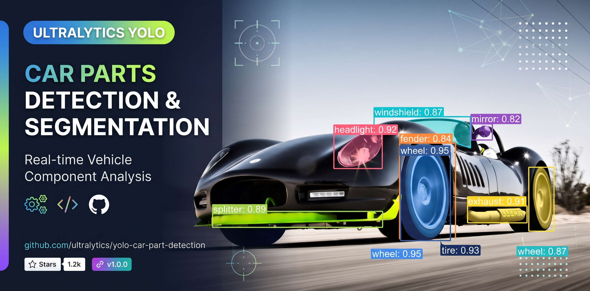

# CarParts YOLO26-seg

<p align="center">
  <a href="https://colab.research.google.com/github/emersonnjsantos/YOLO_CARPARTS/blob/main/yolo_carparts.ipynb"></a>
  <a href="https://www.python.org/"></a>
  <a href="https://github.com/ultralytics/ultralytics"></a>
  <a href="https://www.tensorflow.org/lite"></a>
  <a href="https://www.typescriptlang.org/"></a>
  <a href="https://react.dev/"></a>
  <a href="https://vite.dev/"></a>
  <a href="https://kotlinlang.org/"></a>
  <a href="https://developer.android.com/jetpack/compose"></a>
</p>

Sistema de visão computacional para detecção e segmentação de peças automotivas. O projeto oferece uma experiência web para demonstração e um aplicativo Android nativo para inferência com câmera ou imagens da galeria.



## Visão geral

O CarParts identifica e segmenta **23 classes de peças automotivas** usando um modelo YOLO de segmentação exportado para LiteRT/TensorFlow Lite. As detecções são exibidas com máscaras coloridas, caixas delimitadoras, rótulos e confiança.

### Funcionalidades

- Câmera ao vivo com atualização contínua das detecções.
- Seleção de imagens da galeria e upload de imagens na interface web.
- Catálogo das 23 classes, organizado por região do veículo.
- Ajuste de limiar de confiança, IoU e opacidade das máscaras.
- Alternância independente de máscaras, caixas e rótulos.
- Carregamento do modelo `best.tflite` incluído nos assets do Android.
- Uso de GPU Delegate quando disponível, com fallback para CPU/XNNPACK.
- NMS por classe e restauração das coordenadas após o letterbox 640×640.

## Classes reconhecidas

O catálogo inclui para-choques, portas, vidros, lanternas, faróis, capô, retrovisores, tampa traseira, porta-malas, rodas/pneus e um objeto genérico. A implementação mantém o mesmo catálogo entre a versão TypeScript (`src/ml/yoloEngine.ts`) e a versão Kotlin (`android_app/app/src/main/.../ml/Models.kt`).

## Estrutura

```text
YOLO_CARPARTS/
├── src/                         # Interface React/Vite e pipeline de demonstração
│   ├── App.tsx                  # Navegação, controles e estado da aplicação
│   ├── components/              # Canvas, catálogo, configurações e modelo
│   └── ml/yoloEngine.ts         # Catálogo, NMS, IoU e segmentação
├── android_app/                 # Aplicativo Android nativo
│   └── app/src/main/
│       ├── kotlin/.../camera/   # Preview e integração com CameraX
│       ├── kotlin/.../ml/       # Inferência LiteRT/TFLite
│       └── kotlin/.../ui/       # Compose, estado e overlay de detecção
├── assets/
│   └── social-preview.jpg       # Arte para a prévia social do GitHub
└── package.json
```

## Executando a versão web

Requisitos: Node.js 18+ e npm.

```bash
npm install
npm run dev
```

Abra `http://localhost:3000`. Para validar os tipos e gerar a versão de produção:

```bash
npm run lint
npm run build
```

Os testes do pipeline podem ser executados com:

```bash
node --import tsx --test src/ml/yoloEngine.test.ts
```

## Executando o aplicativo Android

Requisitos: Android Studio, SDK com API 36 e JDK 17.

1. Abra `android_app` no Android Studio.
2. Conecte um dispositivo ou inicie um emulador com câmera.
3. Execute a configuração `app`.

Pelo terminal, no Windows:

```powershell
cd android_app
.\gradlew.bat assembleDebug
```

O modelo padrão deve estar em `android_app/app/src/main/assets/best.tflite`. O seletor de modelo também permite carregar outro arquivo `.tflite` compatível.

## Pipeline de inferência

1. A imagem é redimensionada com letterbox para o tensor de entrada.
2. O modelo produz caixas, classes, coeficientes de máscara e protótipos.
3. As detecções abaixo do limiar de confiança são descartadas.
4. O NMS remove caixas sobrepostas da mesma classe usando o limiar de IoU.
5. As máscaras são reconstruídas e as coordenadas são mapeadas de volta à imagem original.

Valores iniciais da interface:

| Parâmetro | Valor |
| --- | ---: |
| Confiança mínima | `0.25` |
| IoU para NMS | `0.45` |
| Opacidade da máscara | `160` |
| Entrada do modelo | `640×640` |

## Tecnologias

- **Web:** React 19, TypeScript, Vite, Tailwind CSS e Lucide.
- **Android:** Kotlin, Jetpack Compose, CameraX, LiteRT/TensorFlow Lite e Coil.
- **Inferência:** YOLO26-seg com suporte a GPU Delegate e CPU/XNNPACK.

## Licença

Este repositório não contém um arquivo de licença. Defina uma licença antes de distribuir o projeto ou o modelo treinado.
